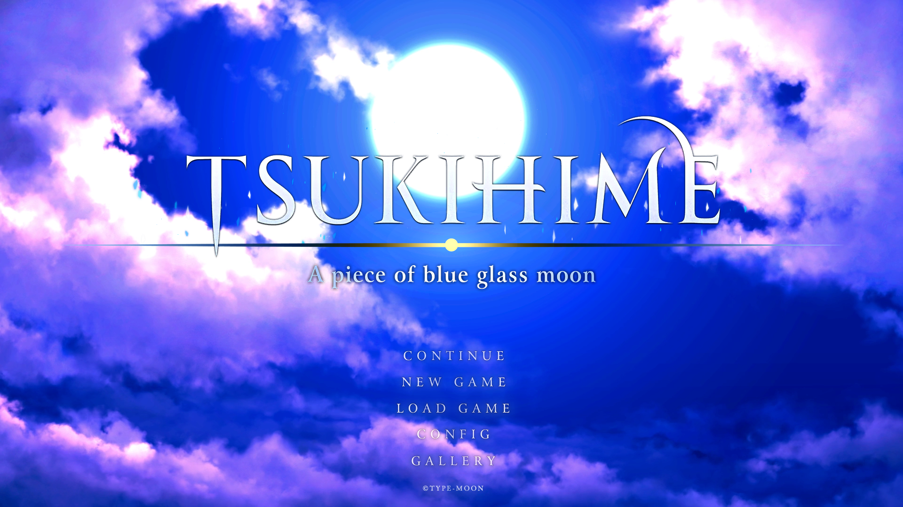
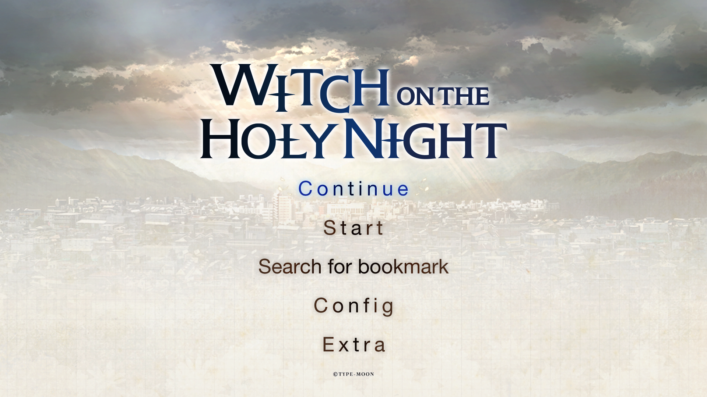

# knife

A Rust reimplementation of the engine of Tsukihime -A piece of blue glass moon- and Witch on the Holy Night for
Nintendo Switch. It plays the games from their Switch releases' data and aims to behave exactly like the
originals: it is heavily based on a decompilation of the original Switch executables, and its behaviour is
checked against the Switch games running in an emulator.





Both releases of Tsukihime are supported: the Japanese one and the overseas one (English, Simplified and
Traditional Chinese besides Japanese). So is the Switch release of Witch on the Holy Night (Japanese, English,
Simplified and Traditional Chinese). knife tells the games apart by their data.

knife is inspired by [shin](https://github.com/DCNick3/shin), DCNick3's reimplementation of the engine of
the Switch visual novels by Entergram, and shares some of its code.

[engine-writeup.md](engine-writeup.md) describes how the original engine works: the game data, the script
machine and its frame loop, text, the stage, sound, saves and the full instruction set, and what Witch on the
Holy Night does differently.

## Game data

knife needs the game data from your own copy of the game:

1. Extract the romfs of the game's Switch release.
2. Add the Switch's shared system font, which the menus and help lines use. Dump
   `nintendo_udsg-r_std_003.bfttf` from the firmware's FontStandard archive (system title 0100000000000811)
   and copy it into the extracted romfs folder, for example:

   ```sh
   hactoolnet -k prod.keys --romfsdir fontstandard <FontStandard>.nca
   cp fontstandard/nintendo_udsg-r_std_003.bfttf <romfs folder>/
   ```

   The Chinese languages of Tsukihime's overseas release and of Witch on the Holy Night also use the Chinese
   system fonts: copy the `.bfttf` files of FontChineseSimplified (0100000000000814:
   `nintendo_udsg-r_org_zh-cn_003.bfttf`, `nintendo_udsg-r_ext_zh-cn_003.bfttf`) and FontChineseTraditional
   (0100000000000813: `nintendo_udjxh-db_zh-tw_003.bfttf`) into the same folder.

By default knife looks for this folder as `assets` next to the executable (inside a macOS app bundle, also
`Contents/Resources/assets`).

### Mod/translation support

Files in a `mod_assets` folder (found the same way as `assets`, or set with `-m`) are used in place of the game
data's files at the same path: an archive's `.hed`, `.nam` or `.mrg`, a movie, a stream, a font and so on. A font
folder (`ja`, `en2`, ...) with files of its own replaces the game data's. Everything else still comes from
`assets`.

## Building and running

```sh
cargo build --release -p knife
./target/release/knife -a <romfs folder>
```

Movies are decoded by the platform: VideoToolbox on macOS, Media Foundation on Windows (N editions need the
Media Feature Pack) and GStreamer elsewhere (with an H.264 plugin such as gst-libav, plus the GStreamer
development packages to build). An `ffmpeg` executable on the `PATH` is used as a fallback.

### Options

| Option | |
|---|---|
| `-a`, `--assets-dir DIR` | the game data folder |
| `-m`, `--mod-assets-dir DIR` | the mod folder, whose files replace the game data's (see above; used only if it exists) |
| `-l`, `--language ja\|en\|zc\|zt` | the language, as the console language and the config's language buttons pick it (Tsukihime's overseas release and Witch on the Holy Night; by default the config's setting) |
| `-s`, `--save-file PATH` | the save file (see below for the default) |
| `-t`, `--text-websocket HOST:PORT` | serve the displayed text over WebSocket for text hookers (e.g. `127.0.0.1:6677`) |
| `-f`, `--fullscreen` | start in fullscreen |
| `--skip-intro` | leave out the TYPE-MOON logo movie and the notice before the title |
| `--skip-movies` | let every story movie be skipped, even the ones the Switch plays through the first time |

With `--text-websocket`, every client receives each message as plain text and each choice's options one per
line; a client that connects late first gets the most recent text.

The default save file is in:

- macOS: `~/Library/Application Support/knife/savedata000`
- Windows: `%APPDATA%\knife\savedata000`
- Linux: `~/.local/share/knife/savedata000` (or `$XDG_DATA_HOME/knife/savedata000`)

Tsukihime's overseas release uses `knife/overseas/savedata000` in the same folder, Witch on the Holy Night
`knife/witch/savedata000`. Settings, unlocks, read text and save slots are all stored in this one file, in the
Switch game's own format, so a save copied from a Switch loads as is, and the reverse also works.

### knife.ini

A `knife.ini` file next to the executable (or in `Contents/Resources` inside a macOS app bundle) can set any of
the options above, one per line, using the long option name without `--`:

```ini
assets-dir = assets
language = en
text-websocket = 127.0.0.1:6677
skip-intro = true
```

Lines starting with `;` or `#` are comments, an empty value leaves an option unset, on / off options take
true or false, and relative paths are resolved from the folder containing `knife.ini`. Options given on the
command line take precedence. See [`knife.ini.example`](knife.ini.example).

## Controls

The keyboard stands in for the Switch controller, and each button does what it does in the Switch game on that
screen (the game's own map is in Config → 操作説明 / controls). The left mouse button is the touch screen; the
mouse wheel or trackpad tilts the left stick.

Game controllers work too: every controller acts as the Switch controller, button for button (A / B / X / Y as
the controller labels them, Plus / Minus as Start / Back).

| Key | Switch |
|---|---|
| Arrow keys | D-pad |
| W / A / S / D | left stick |
| Enter | A (confirm, advance text) |
| Escape, right click | B (cancel, back) |
| B | X |
| M | Y |
| H / J | L / R |
| T / Y | ZL / ZR |
| K / L | right stick up / down |
| O | R3 |
| P | L3 |
| U / I | Minus / Plus |
| F | toggle fullscreen |
| Left Ctrl (hold) | skip text while held |

### In the story

| Switch | Action |
|---|---|
| A | advance text; shows a hidden message window |
| B | stop skipping, else hide / show the message window |
| X | backlog |
| Y | system menu |
| L | auto mode on / off |
| R | skip mode on / off |
| ZL (hold) | rewind |
| ZR (hold) | fast forward |
| Plus or L3 | quick save (Witch on the Holy Night) |
| Minus | quick load (Witch on the Holy Night) |
| D-pad / right stick up | open the mode panel |
| D-pad / right stick down | advance text, close the mode panel |
| D-pad up / down | move between choices |

| Touch (mouse) | Action |
|---|---|
| tap | advance text |
| drag left / right from the middle | rewind / fast forward, faster the further it is dragged |
| flick down from the top edge, or pointer at the top edge | open the mode panel |
| flick up, or tap below the panel | close the mode panel |
| flick right from the left edge | system menu (Witch on the Holy Night: backlog) |
| flick left from the right edge | backlog (Witch on the Holy Night: system menu) |
| pointer at the bottom edge | hide the message window |

The mode panel holds previous scene, rewind, auto, skip, next scene, quick save, quick load and voice replay.

### Menus and gallery

| Switch | Action |
|---|---|
| D-pad / right stick | move the cursor |
| A | confirm (hold A + left / right to drag a config slider) |
| B | back |
| L / R | config tabs; previous / next picture in the CG viewer |
| left stick | scroll lists, the flowchart and the config; move the picture in the CG viewer |
| right stick up / down | zoom in the CG viewer |

A mouse drag scrolls the flowchart, CG list, music list and config, like a touch drag on the Switch.

## License

knife is licensed under the [Mozilla Public License 2.0](LICENSE).
