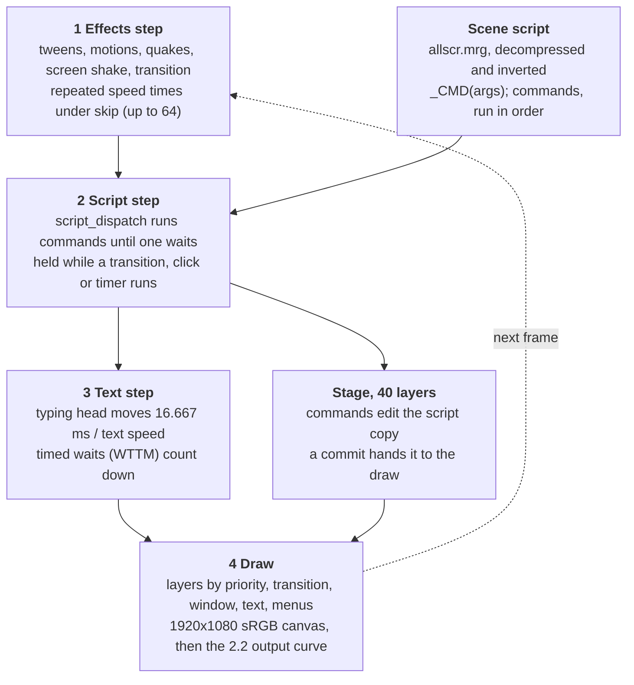

# The Tsukihime Engine

How the Switch release of Tsukihime: A Piece of Blue Glass Moon runs its game, as reverse engineered for knife, the Rust reimplementation: data formats, the script machine, the frame loop, and the full instruction set.

## At a glance



*One engine frame, 4 steps.*

The script step is the only one that reads the scene script, and it changes the picture only through the stage, which the draw sees once a commit hands it over.

## Game data

Everything the game reads lives in its romfs as a handful of big archives, a sound bank, loose Opus streams and MP4 movies. The engine (internally "nexl") also keeps many tables inside the executable itself; knife copies those address ranges into bundles compiled into the binary instead of reading the exe.

| File | Size (JP) | Holds | Format |
| --- | --- | --- | --- |
| `allpac.mrg` | 16 GB | Story images: backgrounds, sprites, effects, rule masks | `.hed` / `.nam` / `.mrg` triple; BNTX textures (mostly BC7 sRGB), some NXGX / NXCX wrapped |
| `allpaccg.mrg` | 1.9 GB | Gallery CGs and flowchart thumbnails | same triple |
| `allpachd`, `allpacml`, `allpachdml` | small | Extra and multi-language image sets (empty or tiny in the JP data, filled in the overseas one) | same triple |
| `allui.mrg` | 71 MB | UI atlases, system message text (SYSMES), button guide cells | same triple |
| `parts.mrg` | 260 KB | Boot logo and caution screens | archive with no name table, read by index |
| `allscr.mrg` | 9 MB | The 548 scene scripts plus the scene name and label tables | `mrgd00` container; scenes are MZX-compressed and bit-inverted |
| `script_text.mrg` | 5 MB | Every message line, per language | `mrgd00`: an offset table and a UTF-8 text block per language |
| `knife1.bfsar` | 386 MB | Sound effects, and the index that maps BGM ids to streams | NintendoSDK sound archive; waves in DSP-ADPCM or PCM16 |
| `stream/` | 1.1 GB | 16,601 `.opus` files: BGM and every voice line | Nintendo Opus |
| `movie/` | 1.6 GB | 46 movies: opening, credits, endings, title backgrounds | H.264 MP4 |
| `ja`, `ja2`, `ja3` |  | Story font (TsukuMin), UI font (TsukuGo), bubble font (FOT-Seurat) | TTF / OTF |
| `exfont_nx01.bffnt` |  | 20 special glyphs that replace dash and box runs | BFFNT bitmap font |
| `shader/` |  | One compiled shader per blend mode (add, burn, dodge, difference, dissolve, ...) | BNSH |

**Archive triples.** A `.hed` holds 8-byte entries (`u32` sector offset, `u16` stored sectors, `u16` unpacked sectors) ending in an all-`0xFF` entry. The `.nam` holds 32-byte NUL-padded names in the same order. The `.mrg` is raw data in 0x800-byte sectors.

**Scripts.** `allscr.mrg` is a `mrgd00` container: a `u16` count, then four `u16`s per entry (sector, offset, size in sectors, low size bits). Entry 0 is the scene name table, entry 1 the per-scene label table, and scenes start at entry 3. Loading a scene MZX-decompresses it (a word-based LZ with a 64-entry ring) and then inverts every byte. What comes out is plain text, a flat run of commands like `_STCH(0,img0597,258-18,154-19,1000,255,2,,CC);` (see The script machine).

**Images.** A script names an image (`img0597`, `BLACK`, `RULE_04`), and the lookup tries `allpac` first, then `allpacml`, then the rest. The executable's image table gives each image its display size, centre, scale level and flags, such as "not moved by the screen shake" or, in the overseas build, "one horizontal strip per language". A texture can be rebuilt through a colour grade (STEC) and a brightness or contrast tone (SNX2 / SNX3) before it is drawn, and is cached under the image name plus those parameters.

**Fonts.** Each language has three font folders: the story text, the UI text and the speech bubble text. The menus also use the Switch's shared system font (`nintendo_udsg-r_std_003.bfttf`), a TTF XORed with a fixed key, which is not in the game data and has to be dumped from the console firmware.

## The script machine

A scene is a flat list of commands with no expressions or nesting: each one is `_` plus a four-character name and a comma-separated argument list, ending in `;`. The interpreter runs commands one after another inside a frame until one of them asks to wait, then picks up again on a later frame.

```
_ZY01c00(LV00000);_STCP(1,1);_STCH(0,img0597,258-18,154-19,1000,255,2,,CC);_FADS(1,0,0);
_SEPL(0,1,MOON_SE03001,,`001:4000,,`017:50);_ZM01801($000107);_IF__(F077,lt,4,LV00100);
```

### Scenes

The game has 548 scenes, from `000_START_SCRIPT` and `001_00_00` (the prologue) to the gallery's `528_ARCHIVE`. A table in the executable maps each scene's script id to its archive index. `JUMP(id, label)` leaves for another scene, optionally at a label. The program counter is simply the index of the command in the scene's `;`-separated list. Save records store byte offsets into the decompressed text instead.

### Command syntax

- **Dispatch.** `script_dispatch` finds the `_`, uses the first letter to index a 26-entry jump table, then compares the other three characters as one 24-bit constant. A name it does not know falls to the default case and does nothing, which is how the PS4-only `SNX4`, `IFNX`, `STQK`, `TRPY`, `WTSV` and `FANX` cost nothing on the Switch.
- **Arguments.** An argument is an integer (decimal, `0x` hex, or small sums like `258-18`), a variable name, a label, an image or sound name, or a `$nnnnnn` text reference. An empty argument (`,,`) means "use the default". Optional parameters can also be passed by key as `` `NNN:value `` (`` `017:80 `` is volume 80, `` `001:4000 `` a 4000 ms fade, `` `068: `` a delay).
- **Messages.** `_ZMsssmm(text)` shows a message. `sss` and `mm` are hex: the read-key slot and the message's position in it, which is how "already read" is tracked. The text is normally a reference such as `$000107` into `script_text.mrg`, so one script serves every language. A trailing code says what follows: no code waits for a click, `@n` and `@e` go on without one once the text is out (`@e` after the voice ends too), `@k` groups the message with the next one, and `MSAD` appends more text to the shown message.
- **Labels.** `_ZZxxxxx(NAME)` and `_ZYxxxxx(NAME)` define labels when the argument is non-empty (2,569 and 1,635 of them). A prepass collects them before the scene runs. `_ZY` also marks a point where the stage backup is refreshed.
- **Inline markup** lives in the text lines: `<漢字|かんじ>` is ruby, `^` breaks a line, and runs of dashes are drawn with special glyphs from `exfont_nx01.bffnt`.

### Variables

All variables are 16- or 32-bit integer words addressed by letter and number. `F12` and `F012` name the same word.

| Bank | Scope | Used for |
| --- | --- | --- |
| `F0`..`F1122` | This playthrough; a chosen subset is saved in each record | Story flags, route state, the window and page state the engine itself keeps (F822 page mode, F823 messages on the page, F1103 text hidden, F110 the current flowchart node) |
| `G` | Global, kept in the system data | Title stage (G002), completion, unlocks; G5, G110+, G300+ and G400+ are bitmaps of movies seen, nodes visited, nodes finished and flowchart edges |
| `Cn` | Alias | Means `F(n + F823)`: per-message words of the current page |
| `Z` | Scratch | Parsed like F and G |

The engine reads and writes some F words itself, so scripts use them as an API. For example, `WKST(F822,eq,1)` turns on page (NVL) mode and the script counts F823 up before each message on a page.

### How a command runs

Each frame the main loop calls `script_dispatch` only while no engine hold is set: a transition in progress, a message waiting for a click, a timed wait, a movie. Dispatch then runs commands until one of them:

- sets a wait (message, `WTTM`, `STCF`, `VCWT`, `TOMW`, a choice);
- asks to run again next frame (`FADS` and `RDAS` hand back their own command until they finish);
- presents a changed stage (`STCH`, `STCC` and `STNS` mark the stage, and it is drawn when dispatch returns);
- ends the scene (`END_`, `RTM_`, `RDED` in a replay).

The stage edits a script makes before a wait are therefore all shown together on one frame, which is why scripts can rebuild an entire scene and reveal it with a single `FADS`.

## Frame loop and timing

The engine is locked to 60 frames a second: every duration in the scripts is converted to whole 60 Hz frames, and every fade, tween and countdown steps once per frame. knife keeps the same 60 Hz clock even on faster displays, so a 120 Hz monitor does not double any speed.

### One frame, in order

1. **Effects step** (`sub_3FBD0`): layer tweens, motions, quakes, the screen shake and the transition progress. Under skip this step repeats *speed* times (1, or up to 64).
2. **Script step** (`sub_802C0`): if no hold flag is set, `script_dispatch` runs commands until the next wait (at most 1,000 in one go). A click wait is cleared first when skipping.
3. **Text step** (`sub_81B30`): the typing head moves on by frame time / text speed, and timed waits count down.
4. **Draw** (`sub_391A0`): the stage layers by priority, the transition over them, the message window and text, the mode icon, then any menus.

After each dispatch the engine looks ahead 24 commands and queues the images they name for loading, so an `STCH` rarely has to wait for its picture.

### Waits

| Wait | Set by | Ends when |
| --- | --- | --- |
| Click | A message with no end code | The player advances, or skip or auto passes it |
| Time | `WTTM(ms, noclick)` | `max(1, ms × 3 / 50)` frames run out; with `noclick` 0, a click ends it early. Even `WTTM(0)` costs a frame |
| Layer | `STCF(layer, mask)` | The layer's tweens in `mask` (position, alpha, zoom, rotation, ...) finish; quakes are not waited on |
| Transition | `FADS` | The crossfade or wipe finishes |
| Voice | `VCWT`, an `@e` message | The voice stops |
| Movie | `TOMW` after `TOMP` | The movie ends, or is skipped where that is allowed |
| Choice | `SELD`, `SELA`, `SELS` | An option is picked |

Some commands always end the frame's dispatch even with nothing to wait for: the window commands `CLO2`..`CLO5`, `MSAD`, `WTTM`, `STCF`, `NOP_`, `END_`, `TOMW` and a `JUMP` to another scene. So a page that starts with `CLO3` runs its next commands a frame after the click that reached it.

### Skip, auto and rewind

- **Skip** passes at most one message per frame, because the click wait is cleared at the start of the script step. The speed (64 in skip mode, or ramping from 1 to 64 while ZR is held) only repeats the effects step and the wait countdowns. In practice a line passes every 2 or 3 frames, about 20 a second. Skip stops at the first unread message unless the player allows unread skipping.
- **Auto mode** waits, once the text is out and the voice has finished, for a fixed time set in the config: 3,000 ms by default at a page end, 2,200 ms at a click wait inside a page (each 0 to 10,000 ms).
- **Rewind** (ZL) walks back through the history ring one entry per frame, putting back each entry's stage, with the text hidden while it runs. Letting go shows the message it landed on, typed out in full.
- **Next-scene seek.** Jumping forward to the next scene, from the flowchart or the mode panel, runs the script at full speed inside one frame, with no drawing and no sound. It stops at the target's first message or save point, then puts back the BGM and looping sounds the target should have.

## Text and the message window

Tsukihime is a page novel: in page mode (F822 = 1, which `START_SCRIPT` sets) messages stack on a dark full-screen band until the script starts a new page, and the reader sees the whole page at once. The engine keeps two separate fades for this, one for the window and one for its content, and the script steers them with four window commands.

### Pages

- The script counts F823 up before each message on a page and resets it at a page end. A message with F823 ≤ 1 starts a fresh page; otherwise the last F823 − 1 messages stay above it.
- `PGST(id)` only records the page id in F1122. A save made inside the page resumes at that page's first message, and a record of an unusual type restarts the scene from the id.
- Earlier messages on the page dim from full white to 100/255 over 1.2 × the text speed in frames, starting when the next message starts. A run of messages joined by `@k` dims together.
- `WNTY(type)` picks the window style (F1105): 0 to 2 are full-screen bands, and 3 to 32 are the "Teach me, Ciel-sensei" corner speech bubbles, which use their own font and are drawn at 78% alpha.

### Typing

Each frame the text head moves by 16.667 ms / text speed characters. The defaults are 35 ms a character for unread text and 15 ms for read text, and either can be set to instant. The head is held:

- for 2 frames after a new message starts, as the text slot lays itself out;
- while the window is still fading in, or its content fade is still running, unless the text is hidden (F1103). So after `CLO3` the new message's bubble comes in over about 9 frames and the text starts typing on the next one.

When the head reaches the end, the click wait is armed the frame after, and the script moves on the frame after that.

Lines wrap at a fixed character count for the slot width: 28 full-width characters in the message window. Japanese kinsoku characters never start a line. English text (overseas build) uses nn::font's UAX #14 line breaker over the executable's own tables, at 0.9 × the glyph size. Inline tags such as `[heart]`, `[onpu]` and `[ber05]` become glyphs from `exfont_nx01.bffnt` or drawn bars, and "…" is stretched across its whole cell.

### Window and content fades

| State | Moves | Rate |
| --- | --- | --- |
| Window alpha | Toward shown (1) or hidden (0) | Linear, full in 128 ms (about 8 frames); a quick hide drops 0.26 a frame |
| Content B0 | Text and click icon brightness | Over 18 frames at a message after the window was off; over `ms` for `CLO4` / `CLO5` |
| F1103 | Text hidden until the next message | Set by `CLO2`, `CLO3`, `FADS` arg 3, `STMA` arg 2, choices; cleared by every message |

The window is drawn into its own layer, the text into another, and both are composited at window alpha × 2 × max(B0 − 0.5, 0). The text therefore appears only in the second half of a content fade, and the content factor is applied twice. While F1103 is set the window layer is not composited at all, so `CLO2` and `CLO3` remove the window in a single frame.

| Command | Effect |
| --- | --- |
| `CLO2()` | Clear the page's messages; window off at once; F1103 = 1 |
| `CLO3()` | Hide a shown window (gone at once, since F1103 = 1); the page text is kept and comes back with the next message. The most used window command (12,208 uses) |
| `CLO4(ms)` | Fade the content out over `ms` |
| `CLO5(ms)` | Window to full alpha now, content fades in over `ms`, F1103 = 0 |

### History and backlog

Every message, choice and save point pushes an entry onto an 800-entry history ring. Each entry holds the scene position, the stage, the BGM, the looping sounds and the message text. The ring serves:

- the backlog (X), which lists the entries newest first, leaving out the page currently on screen;
- rewind, which steps back through it;
- save records, which are a copy of the newest entry.

A scene point (`ATSV`) is a ring entry the "previous scene" button can return to.

## Stage and transitions

The picture is a stack of 40 layers, each showing one image or a solid colour. Scripts build the next picture by editing layers out of sight, then reveal it with `FADS`, which crossfades, wipes or cuts from the frame the player last saw.

### Layers

- **Coordinates.** Positions are in a 480 × 272 script space centred at (240, 136), scaled to the 1920 × 1080 canvas. Zoom is ×1000, rotation is in 1/100 degree, and alpha runs 0 to 255.
- **Priority** orders the draw (higher is in front). A layer with priority 0 is not drawn, and `STCH` defaults to 10 × the layer number, so layer 0 starts hidden. The scripts commonly put a black 1380 × 820 curtain (`img0597`) at priority 2 as the base.
- **Parents and clipping.** A layer can be clipped to a parent layer's rectangle with a soft inset (STCH args 11 to 17), take another layer's transform as its base (`SBAS`), and be turned with the clip (`STRR`).
- **Per-layer look:** a blend mode (`STBR`, about 30 Photoshop-style modes such as add, multiply, screen, overlay, dodge, burn and difference), a colour grade (`STEC` modes 2 to 82, such as sepia), brightness and contrast (`SNX2` / `SNX3`), film grain (`STNS`), heat haze (`STRA`) and a rule mask for its own fades (`STTR`).

### Three copies of the stage

The engine holds the stage three times: the **script copy** that commands edit, the **presented copy** that the draw reads, and a **backup** used for saves and history.

- Some edits only reach the screen at the next commit: a new image (`STCH`), priority (`STCP`), blend (`STBR`), parenting (`SACL`, `SBAS`), `SOXY` and `STRR`. A commit happens at a `FADS`, when the dispatch returns after an `STCH` / `STCC` / `STNS`, at a load, or at the end of a seek. So `STCP(l, 0); WTTM(400)` keeps the layer up through the wait.
- Tweens act on the screen at once: position (`STCL`), alpha (`STGS`), zoom (`STZ4`), rotation (`STRT`), as well as motions, quakes and haze.
- Colour grades and tones are baked into the layer's texture, so they take effect the next time its image is built.

### Tweens and motions

Position, alpha, zoom and rotation each tween from their last target to a new one over `ms`, with an ease. `STCF` waits on any of them. `STMA(layer, id)` instead attaches one of the motions baked into the executable: keyframe tables with up to 27 fields (position, alpha, pivot, rotation, zoom, clip, blend, colour, image variant, tone, grain, priority). They are sampled by step, linear or natural cubic spline, and some loop. `SGMA` patches a motion key with the layer's current values, so a motion can start from wherever the layer is now. `SPMA` pauses or resumes all motions.

### FADS: the transition

`FADS(mode, ms, rule, text)` reveals the edited stage:

| Mode | Effect | Uses |
| --- | --- | --- |
| 0 | Crossfade from the captured last frame to the new stage over `ms` | 12,240 |
| 1 | Cut; `FADS(1,0,0)` alone is 20,591 of these | 20,842 |
| 2 | Wipe through rule mask `RULE_nn` (`rule` = nn + 1) over `ms` | 947 |

Argument 3 = 1 hides the text until the next message (2 does so only for a fade of 2 ms or more with no content fade running).

Internally FADS is a small state machine that hands back its own command each frame:

1. Capture the screen.
2. If the stage changed, present it under the capture and hold one frame.
3. Wait until every image is loaded.
4. Start the transition.
5. Return once the transition flag clears.

An instant FADS of a changed stage therefore lets the next command run four frames later, with the new picture visible from the third frame.

The rule wipe uses a soft edge of width `v`. For each pixel with rule value `r`, at progress `A`:

```math
e = \frac{(255 + 2v)A - v}{255}, \qquad t = \mathrm{sat}\left(\left(r - e + \frac{v}{510}\right)\frac{255}{v}\right)
```

### Screen effects

| Effect | Commands | What it does |
| --- | --- | --- |
| Screen shake | `SHOK`, `SHAF` | Sine shake of the whole screen for N cycles; SHAF stops it or fades it out over `ms` |
| Layer quakes | `SQK2`, `SHK2`, `SSW2`; stop with `SQS2`, `SHS2`, `SSS2` | Random jitter, sine shake or slow sway of one layer (or all), in two slots per layer, with delay, ramp and duration |
| Message shake | `MSQK` | Jitters the message text for `ms`, a new random offset each frame |
| Focus | `FCLN`, `FCSP` | One of the engine's blur / focus effects from a table; FCSP fades it out |
| Ghosting | `FADE(40, p, q)` / `FADE(41)` | The channel-split "ghost" effect of the apparition scenes, on and off |
| Staff roll | `XSTP`, `XRSM` | Starts and ends the credits task |

### Rendering

Everything is drawn into a fixed 1920 × 1080 canvas through sRGB render targets, with blending done on the stored gamma values. Every texture first goes through the `pre_alter` shader, which also applies a layer's grade and tone. The final blit raises the frame to the power 2.2 and writes it to an sRGB swapchain. This output curve is why the Switch's dark tones look the way they do, and knife reproduces it exactly.

## Sound

Sound runs on nn::atk with one BGM player, two voice players and 20 numbered SE channels the scripts address directly. Every volume is a 0 to 100 word that fades by a fixed number of points per frame, multiplied by the player's config category and mapped through a curve.

| Player | Source | Script commands | Volume curve |
| --- | --- | --- | --- |
| BGM | `stream/*.opus`, by BGM id through the BFSAR | `MPLY`, `MFAD`, `MVOL` | Quadratic ease (control 0.77), then the 100-point table `sub_CA0` (about −12 dB at 0.12) |
| Voices | `stream/*.opus`, by line name | `VPLY`, `VPL2`, `VCWT` | Linear, per speaker row |
| SE channels 0–19 | `knife1.bfsar` waves (DSP-ADPCM) | `SEPL`, `SEFD`, `SEVL`, `SESP` | `sub_CA0`, or the speaker's voice volume when bound to one |

- **BGM.** `MPLY(n)` leaves an already playing track alone. With a fade-in (key 1) the old track fades out while the new one rises, and without one it cuts. Only `MPLY` marks a track as heard for the music gallery.
- **Voices.** `VPLY(name)` doesn't play anything itself: it hands the voice to the next message, which plays it and makes it the line's replay voice. `VPL2` plays at once. A voice is skipped when voices are off or its speaker's row is muted in the config (19 speaker rows).
- **SE.** `SEPL(ch, loop, name, ...)` with keys for volume (17), fade-in (1), pan (18), delay (68) and speaker binding (70). A delayed SE is queued on its channel and counted down in frames. A looping SE already playing on its channel is left alone. Looping SEs are stored in each save record and restarted on load.
- **Defaults.** BGM and SE 40, system SE 10, voices 50.
- **Timing.** An SE starts at the end of the frame that ran its command. A stream (BGM or voice) starts a frame later, once its first blocks are loaded. The script sees a sound as stopped three frames after its last sample, so `VCWT; SEPL` starts the effect about 55 to 75 ms after the voice ends.
- **Pan law.** Mono sources come out at 1/√2 per side at the centre. Stereo streams play at 0.68 of the curve, and stereo waves at full level.
- **Ending a scene** (`END_`, `RTM_`) stops every SE channel and the voice. It also stops the BGM unless `RTMN` or `RTM2` asked to keep it.

## Saves and system data

The whole save is one file, `savedata.bin` (0x3E7000 bytes). It holds the config, the global G words and unlock bitmaps, the read-text keys and 140 save records. knife reads and writes the Switch's format byte for byte, so saves move freely between the two.

### Slots

| Records | Role |
| --- | --- |
| 0–99 | The 100 slots of the save / load list |
| 100–138 | Auto saves: each new one shifts the others down a slot and the oldest drops out. The load list does not show them, but CONTINUE resumes the newest |
| 139 | Quick save (CONTINUE never picks it) |

### A record

A record (0x7140 bytes) is a copy of a history-ring entry plus the previous choice and the date. Saving does not snapshot the running engine. It stores what the page looked like when its first message appeared, so a save always resumes at the start of its page.

| Field | Holds |
| --- | --- |
| Position | Scene number, byte offsets of the resume command and the next one |
| Message | Its read key, the raw text argument, and the entry type (message, save point, choice, ...) |
| Stage | The full 40-layer stage block (0x19B8 bytes) and its backup: image, position, alpha, priority, rotation, zoom, pivot, parents, clip, motion and frame, quakes, grain, grade, tone |
| Sound | BGM and volume; each SE channel's loop, volume, pan and any queued delayed command |
| Variables | A fixed subset of the F words: 38 words, 42 bits and 274 low bytes |

Loading clears every F word, restores the subset, rebuilds the stage, restarts the BGM and loops, and lays out the page's message again. The save-list thumbnail is not a stored picture: it is redrawn from the record's stage, using thumbnail copies of the images.

### System data

- **Read keys.** 4,020 bytes: a message `_ZMsssmm` counts as read when `read[sss] ≥ mm`. Skip stops at the first unread message.
- **Seen and heard bitmaps.** Every image the stage shows (gallery unlocks), every BGM `MPLY` starts, every movie watched.
- **Flowchart.** The global bitmaps of nodes visited (`RDST`) and finished (`RDED`) and edges walked. Each playthrough also keeps its own copy in F words, so the in-game chart shows the current run.
- **Config.** Volumes, text speeds, auto waits, skip settings, language, per-speaker voice switches and the rest, with the executable's defaults.

## Instruction set

The Switch scripts use 93 command names plus the three `_Z` macros, 1,082,419 commands in all. Six of the names are PS4 leftovers that the Switch dispatcher drops. Arguments are listed in order; `=` gives the default for an empty argument, and `` `NN `` marks a keyed argument. Use counts are across all 548 scenes.

### Flow and variables

| Command | Arguments | Effect | Uses |
| --- | --- | --- | --- |
| `WKST` | var, `eq`, value | Set a variable (the middle word is fixed) | 487,136 |
| `WKAD` | var, value | Add to a variable | 45,691 |
| `WKOR` | var, value | Bitwise OR into a variable | 21 |
| `IF__` | a, op, b, label | Go on if `a op b` holds, else jump to the label. Ops: `eq ne gt lt ge le`, and `an` (a AND b ≠ 0) | 1,194 |
| `GOTO` | label | Jump within the scene | 101 |
| `GOTS` | var, label0, label1, ... | Jump to the label the variable's value picks | 170 |
| `JUMP` | scene id, label | Go to another scene (and mark the flowchart edge) | 1,741 |
| `IFSC` | \_, label | Go on when started from the gallery, else jump | 2 |
| `IFUR` | \_, label | Jump when every Q&A ending node (533–556) is complete, else go on | 1 |
| `IFP4` | \_, label | Always jumps on the Switch, skipping a PS4-only block | 204 |
| `IFLA` | language, label | Overseas build only: go on in that language, else jump | 0 (JP) |
| `WTTM` | ms, noclick | Wait `max(1, ms × 3/50)` frames; a click ends it unless `noclick` | 14,828 |
| `END_` |  | End the story: stop the sounds and fade to black, then back to the title (or to the gallery in a replay) | 519 |
| `RTM_` |  | End the story like END\_; the two differ only in the end result the title and gallery act on | 544 |
| `RTMN`, `RTM2` |  | `RTMN` ends the scene but keeps the BGM playing; `RTM2` only sets that keep flag | 1 each |
| `NOP_` |  | Nothing, but ends the frame's dispatch | 1 |

### Messages and the window

| Command | Arguments | Effect | Uses |
| --- | --- | --- | --- |
| `_ZMsssmm` | text | Show a message; `sss` / `mm` are its read key. End codes: none waits for a click, `@n` / `@e` go on, `@k` joins it to the next | 42,601 |
| `MSAD` | text | Append text to the shown message (same end codes) | 678 |
| `_ZZ`, `_ZY` | label | Label definitions; `_ZY` also refreshes the stage backup | 2,569 / 1,635 |
| `PGST` | page id | Record the page id in F1122 | 17,202 |
| `CLO2` |  | Clear the page; window off; text hidden | 5 |
| `CLO3` |  | Hide the window; the page is kept; text hidden until the next message | 12,208 |
| `CLO4` | ms | Fade the window content out | 978 |
| `CLO5` | ms | Window on at full alpha; content fades in | 596 |
| `WNTY` | type | Window style (0–2 bands, 3–32 Q&A bubbles); also F799 = page break | 58,576 |
| `MSQK` | ms = 1000, ax = 5, ay = 5 | Shake the message text for `ms` (capped: over 10,000 becomes 1,000) | 30 |

### Choices

| Command | Arguments | Effect | Uses |
| --- | --- | --- | --- |
| `SELR` | value, text, disabled | Add an option (numbered "１．", "1. " in English); 1 in the third argument greys it out | 823 |
| `SELD` | var | Show the options as lines under the page; store the picked value | 170 |
| `SELS` | var | Yes/No question for the hint corner; stores 0 or 1 | 1 |
| `SELA` |  | "Save your progress?"; Yes opens the save screen | 26 |

### Stage layers

| Command | Arguments | Effect | Uses |
| --- | --- | --- | --- |
| `STCH` | layer, image, x, y, zoom, alpha, prio, \_, \_, variant a, variant b, clip parent, clip x, y, w, h, inset, inset mode, \_, clip rotation | Put an image (or `BLACK`, `WHITE`, ...) on a layer; shown from the next commit. Args 7–8 (`,CC` in the scripts) are not read | 54,503 |
| `SCH2` | as STCH, arg 18 = source layer | STCH that copies a source layer's state (quakes, pivot, effects) | 4,674 |
| `STCC` | layer = 0 | Clear a layer, or all of them for −1 | 63,260 |
| `STCP` | layer, prio | Draw priority; 0 hides | 51,568 |
| `STCL` | rel, layer, x0, y0, x1, y1, ms, ease (or rel, layer, dx, dy, ms, ease) | Move; stops the layer's motion | 9 |
| `STGS` | layer, from, to, ms, ease | Alpha tween (0–255) | 8,114 |
| `STZ4` | layer, zx0, zy0, zx1, zy1, ms, ease | Zoom tween (×1000) | 32,319 |
| `STRT` | layer, from, to, ms, ease | Rotation tween (1/100 degree) | 21,691 |
| `STPV` | layer, px, py, rot | Set the pivot that zoom and rotation turn about | 734 |
| `STCF` | layer, mask = 63 | Wait for the layer's tweens (all layers for −1) | 5,179 |
| `SACL` | layer, on | Absolute flag: ignore the clip parent's transform | 450 |
| `SBAS` | layer, base | Take another layer's transform as base | 943 |
| `SOXY` | layer, \_, \_, dx, dy | Draw offset | 208 |
| `STRR` | layer, r | Clip rotation for children (−99999 follows the child) | 448 |
| `STBR` | layer, mode, override | Blend mode | 14,946 |
| `STEC` | layer, mode, colour | 0 reset, 1 colour fill, 2–82 colour grade (applied at the next image build) | 12,906 |
| `SNX2`, `SNX3` | layer, v | Brightness 1 + v/255, contrast 1 + v/100 (baked into the texture) | 1,678 / 845 |
| `STNS` | layer, n | Film grain n (0 off) | 196 |
| `STRA` | layer, id, ms | Heat haze from the haze table (−1: every layer with an image) | 569 |
| `STTR` | layer, rule, flip | Make the layer's own alpha fades wipe through `RULE_nn` | 110 |
| `STMA` | layer, motion id, text, start | Attach a keyframed motion from the executable's tables | 24,333 |
| `SGMA` | layer, motion id, key | Write the layer's live values into a motion key | 109 |
| `SPMA` | pause | Pause (1) or resume (0) every motion | 199 |
| `SPFC`, `SPRD` | layer, image, ... | Preload an image, or its expression variants | 487 / 36 |
| `SPRC` |  | Release render targets (nothing visible) | 85 |
| `STCG` | image | Only marks the image as seen for the gallery | 39 |

### Transitions and screen effects

| Command | Arguments | Effect | Uses |
| --- | --- | --- | --- |
| `FADS` | mode, ms, rule, text | Present the stage: 0 crossfade, 1 cut, 2 rule wipe (see Stage and transitions) | 34,029 |
| `SHOK` | ax, ay, period = 300, count = 3, delay | Sine shake of the screen | 870 |
| `SHAF` | ms | Stop the shake, or fade it out over `ms` | 397 |
| `SQK2` | layer, ax = 15, ay = 15, period, dur, delay, follow, ramp | Random layer quake | 1,236 |
| `SHK2` | layer, ax, ay = 15, period = 300, dur, delay, fade, ramp, sparse | Sine layer shake | 125 |
| `SSW2` | layer, amp min, amp max, period min, period max, strength, dur, delay | Slow layer sway | 200 |
| `SQS2`, `SHS2`, `SSS2` | layer | Stop the matching quake (all layers for a negative layer) | 532 / 400 / 398 |
| `FCLN` | ..., effect | Turn on a focus / blur effect (only argument 5 counts) | 26 |
| `FCSP` | ms | Fade the focus effect out | 31 |
| `FADE` | 40, p, q / 41 | Ghosting channel-split effect on / off | 61 |
| `XSTP`, `XRSM` |  | Start / end the staff roll task | 2 each |

### Sound and movies

| Command | Arguments | Effect | Uses |
| --- | --- | --- | --- |
| `MPLY` | n, `` `017 `` volume, `` `001 `` fade-in, `` `011 `` fade-out, `` `069 `` start sample | Play BGM n (−1 stops) | 1,171 |
| `MFAD` | `` `001 `` ms | Fade the BGM out | 724 |
| `MVOL` | `` `001 `` ms, `` `017 `` volume | Change the BGM volume | 780 |
| `SEPL` | ch, loop, name, `` `017 `` volume, `` `001 `` fade, `` `018 `` pan, `` `068 `` delay, `` `070 `` speaker | Play a sound effect on channel 0–19 | 14,543 |
| `SEFD` | ch, `` `001 `` ms | Fade a channel out (all for a negative channel) | 3,516 |
| `SEVL` | ch, `` `017 `` volume, `` `001 `` ms | Change a channel's volume | 1,285 |
| `SESP` | ch | Stop a channel at once | 18 |
| `VPLY` | voice | The next message plays this voice | 16,690 |
| `VPL2` | voice | Play a voice now | 16 |
| `VCWT` |  | Wait for the voice to finish | 75 |
| `TOMP` | n | Play movie n (the language's copy); unwatched story movies cannot be skipped | 48 |
| `TOMW` |  | Wait for the movie | 48 |

### Progress and the flowchart

| Command | Arguments | Effect | Uses |
| --- | --- | --- | --- |
| `ATSV` | flags | Save point and scene point: pushes a history entry; bit 2 = no scene point, bit 3 = do nothing | 398 |
| `RDST` | node | Mark a flowchart node visited | 530 |
| `RTST` | node | Enter a node in this playthrough (sets F110 for some nodes) | 527 |
| `RDED` | node | Mark the node finished; a gallery replay ends here | 550 |
| `RDAS` | node | With "auto skip read scenes" on and the node finished, ask to go to the next scene | 530 |

### Ignored on the Switch

`SNX4` (8,762 uses), `FANX` (2,741), `IFNX` (234), `WTSV` (28), `STQK` (3) and `TRPY` (2) fall through the dispatcher's default case. `FANX` is still read by the image look-ahead, which only preloads.

## Menus and the overseas build

The menus are engine code, not script: hand-written state machines that step their fades every frame and draw sprites from the UI atlases in `allui`.

### Boot and title

- **Boot.** After the opening has been seen once (flowchart node 485 read), the TYPE-MOON logo movie plays over white, then the caution screen, then the title fades in from black. A fresh profile skips all of that and starts the prologue (scene id 260) at once. The first run shows PRESS ANY BUTTON over `title_bg0`, then the cautions, then `START_SCRIPT`.
- **Title.** The background movie and logo depend on the title stage (G002, which moves on as routes are completed): `titlebg1` to `titlebg4`, and BGM 2, or 72 at the last stage. Logo shards and dots are particle systems. The menu offers CONTINUE (the newest save), NEW GAME, LOAD GAME, CONFIG and GALLERY.
- **Loading from the title.** Confirming a slot closes the load screen over the title, fades the BGM out at 1.5 points a frame, hides the menu, fades to black at 0.01 a frame, then loads.

### In the game

- **System menu** (Y, or a flick from the left edge): blurs the frozen scene (a captured frame, blurred over two frames) behind five tabs: save, load, config, the in-game flowchart and back to the title. Closing fades the menu and its backdrop out over 30 frames, then cuts the blur.
- **Mode panel** (up, or a flick down from the top): skip, auto, quick save and load, rewind, and jump to the next or previous scene. A scene jump runs a 20-frame countdown that darkens the screen.
- **Touch.** Taps advance, a drag in the middle of the screen rewinds or skips, and a touch near the bottom hides the window. Taps leave ripple effects. The backlog opens with X or a flick from the right edge.

### Gallery

Five modes: CG viewer, music player, flowchart, movies and endings.

- **CGs.** 458 groups. An entry unlocks once its image (or an alias of it) has been shown in the story.
- **Music.** 95 tracks. A track unlocks once its BGM has been heard.
- **Flowchart.** The node chart, with jumps that restart a node's scene with the playthrough state reset to that point.
- **Endings.** Replays run the gallery scene `528_ARCHIVE` with F024 set, end at the node's `RDED`, write the system data and reopen the gallery on the entry that was replayed. Completing `QA_25` sets node 557, which unlocks every CG.

### The overseas build

The overseas release (Tsukihime -A piece of blue glass moon-, with English and Chinese) is the same engine with a few hundred changed functions. knife tells the two apart from the data (`w_allpac.nam` present) and runs either from the same code.

| Area | Japanese build | Overseas build |
| --- | --- | --- |
| Languages | Japanese only | Japanese, English, Simplified and Traditional Chinese, picked in the config or from the console language |
| Archives | `allpac`, `allui`, ... | `w_allpac`, `w_allui`, ... with 140 extra images; some images stack one strip per language |
| Script text | One text block | One block per language in `script_text.mrg`, chosen by `$` references |
| Script commands |  | `IFLA(language, label)` for language-specific branches |
| System text | `SYSMES_TEXT` | `SYSMES_TEXT_ML`, with one message ("Deleted") inserted at 217, so later ids shift by one |
| Text layout | Fixed character grid, kinsoku | English at 0.9 × size with UAX #14 line breaking; wider windows, backlog and choice layouts |
| Fonts | TsukuMin, TsukuGo, FOT-Seurat | Per-language folders (`en`, `en2`, `en3`: Helvetica, DemosNext, FOT-Seurat); CFF glyphs with trailing data after `endchar` are cleaned up before drawing |
| Movies | One copy | `_en`, `_zc` and `_zt` copies of the prologue, openings and phase titles |
| UI | Japanese atlases | `name_<language>` atlases, per-language logo slices and phase-title cells |
| Endings gallery | Unlocked by the node bit | Unlocked by its completed nodes (G300 bits) |
| Save file |  | Same format, so saves are interchangeable apart from the language setting |

## Sources

This document summarises the knife repository. The details, with executable addresses and the Switch captures behind each number, are there:

- `re/NOTES.md`: reverse-engineering notes on the Japanese executable (`main.elf`, build f4b3318d561e0345), about 2,500 lines.
- `re/NOTES_EN.md`: what the overseas build (d10d239aade1d526) changes.
- `knife-core`: formats (archives, MZX, BNTX, fonts) and the script parser.
- `knife/src/game.rs`: the interpreter, with one commented arm per command.
- `knife/src/stage.rs`, `motion.rs`, `grade.rs`: the stage, motions and colour grades.
- `knife/src/savedata.rs`: the save file layout.
- `knife-audio`, `knife-render`: sound playback and the wgpu renderer.
- Use counts: a scan of all 548 decompressed scenes from the Japanese `allscr.mrg`.

The function names (`sub_...`) are addresses in the Japanese executable as loaded by `tools/nso2elf.py`.
